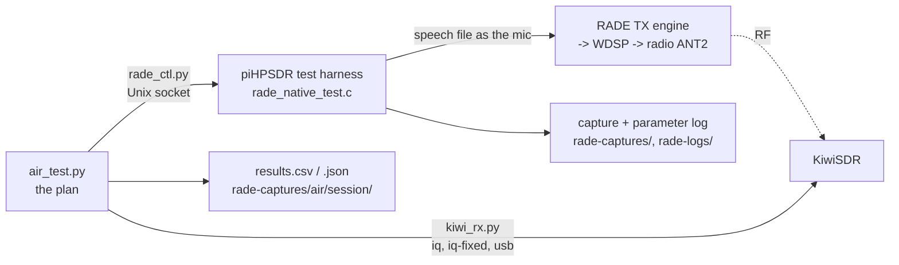

# RADE native: automated over-the-air tests

Purpose: validate and tune the transmit pipeline (timing, levels, the ALC) with repeatable overs, recorded on
both sides - piHPSDR's own captures and a KiwiSDR - without anyone clicking through the GUI.

## How it fits together

The harness replaces the mic with a WAV file *inside* the RADE transmit engine (`rade_native_tx_inject`), so the
whole of the transmit chain from the leveller to the radio is exercised, and what is sent is exactly the file -
no sound card, no TCI audio stream, no timing slop from either. (TCI audio would exercise piHPSDR's TCI input,
which is not what is being tested.) The radio is keyed with the normal MOX path, so the end-of-over hold,
WDSP's TX slew and the P2 output are the real ones.

## Safety

- **The operator arms it**: RADE window, **Test harness** tick. Off whenever piHPSDR starts, off when the window
  closes, off if unticked (which also stops any over at once). Unarmed, the socket answers `status` and refuses
  everything else.
- **Hard limits** (constants at the end of `src/rade_native_menu.c`; a change is a rebuild, not a command):
  the transmitter's drive setting at most `TEST_MAX_DRIVE_PCT` (20 %; was 1 % for the first run); the dial inside 28.000-29.700 MHz; an over
  at most 90 s; not with PureSignal, tune or two-tone on.
- **A script cannot change the drive setting or the antenna**; the operator sets those (ANT2, 28 MHz band,
  drive 20 %) and `air_test.py` shows them at the start. What a script can set is the digital level into the
  transmit chain (`drive_db`, -60..+6 dB around the defined level), the mic trim and the leveller.
- A client that goes away during an over releases the transmitter; so does `abort`, and the harness only ever
  releases a key that it pressed.
- The operator should be watching: `air_test.py` waits for Enter (`--yes` to skip it).

## Running

1. piHPSDR running with `RADE_NATIVE=ON`, ANT2, drive 20 %, RADE window open, **Test harness** ticked.
2. `python3 test/rade_native/air_test.py --freq 28645 --wave v1,v2 --levels -30,-24,-18,-12,-6,-3,0,3,6`
   (20 s clip of `rade_c`'s `david_vk5dgr.wav` by default; `--clip` for another, `--seconds`, `--repeat`,
   `--agc` to leave the leveller on, `--trim`). About 70 s a run.
3. `results.csv` in `rade-captures/air/<session>/`: one row per run.

Single commands: `rade_ctl.py status | set wave=1 dial=28645000 drive_db=-6 | capture on | log on | play f.wav | abort`.
`--dry-run` does the Kiwi side only (no harness, no transmission).

## Weak signals from strong recordings (`air_weak.py`)

The received power cannot be lowered on the air without changing the ALC state (the digital level is the only
knob), so *does the ALC cost anything when the signal is weak?* is answered afterwards: `air_weak.py SESSION`
takes the Kiwi's fixed-gain recording of each run and emulates a path loss of A dB - the signal scaled down by A,
white noise added so that the noise in the modem band is what the Kiwi measured when nothing was sent - then decodes
it as the real recordings are, with several noise realisations. Every transmit level is thereby judged against the
same noise floor with its own received power, and the table (`weak.md`) shows, per path loss, sync, callsign,
end-of-over and feature loss against the level. A few real runs at low level are in the plan to check the method
(a real run at SNR s should read like an emulated one from a higher unclipped level at the same s). Limits: additive
white noise only (no fading), the noise is assumed flat across the 1.6 kHz band, and one clip.

`band_snr_db` (in `results.csv`) is the SNR from the band power on and off in the fixed-gain recording: independent of
librade's estimate, which tops out near 32 dB (V1) and 18 dB (V2).

## What a row holds

| Column(s) | Meaning |
|---|---|
| `wave`, `level_db`, `freq_khz` | what was run |
| `t_call`, `t_keyed`, `t_inject_start`, `t_inject_end`, `t_unkey`, `t_released` | unix times on this machine: key to first speech sample to release; the end-of-over hold is `t_released - t_inject_end` |
| `capture_stem`, `log_file`, `kiwi_session` | where each side's data is |
| `tx_peak_dbfs`, `tx_rms`, `tx_crest_db`, `tx_at_ceiling_pct` | the WDSP TX output block (192 kHz on P2): how close to, and how much of the over was against, the ALC ceiling |
| `tx_shape`, `tx_shape_pass` | `tx_shape.py`: energy centre and tilt |
| `band_snr_db`, `band_sig_dbfs`, `band_noise_dbfs` | from the fixed-gain recording (see above) |
| `iq_*`, `iq_fixed_*` | the Kiwi (AGC on / fixed gain): `sync_pct`, `snr_mean`, `snr_min`, `snr_max`, `foff`, `eoo_ok`, `call_ok`, `feature_loss` and `speech_env_corr_vs_ideal` against the speech sent |
| `kiwi_over_start_s` | where the over starts in the Kiwi recording (not tied to the key: the recordings have no time stamps, so the air delay is not measured) |
| `mic_lufs`, `mic_peak_dbfs`, `mic_limiting_pct`, `tx_underruns`, `agc_db_max` | from the parameter log, while keyed: the mic as the engine measured it (gated LUFS, peak before the limiter, share of 100 ms blocks in which the mic limiter had acted in the last second), transmit underruns |

## Reading a level sweep

- Below the ALC (negative `level_db`): `iq_snr_mean` should rise with the level dB for dB. Where `sync_pct`
  falls under 100, or `call_ok` fails, is the recovery threshold at the noise floor *for that path on that
  day*; the Kiwi's own noise and the band's change, so repeat runs (`--repeat`) and interleave levels.
- Around 0 and above: `tx_at_ceiling_pct` rising and `tx_peak_dbfs` stuck at the ceiling mean the ALC is acting;
  the question is whether `iq_snr_mean` and `feature_loss` still improve or turn over (offline, 0 to +9 dB gave
  nothing more out of the ALC - `alc_sweep.py`; this is the same question on air).

## Status

Built 2026-10-16. Tested: the socket server, WAV loader and the play sequence against a stand-in
(`test_ctl.py`, in `make check`); `air_test.py` end to end against that stand-in with the real Kiwi (no
transmission). **Not yet run on a radio**: the GTK side of the harness (arming, `set`, keying) and everything
that needs RF.
