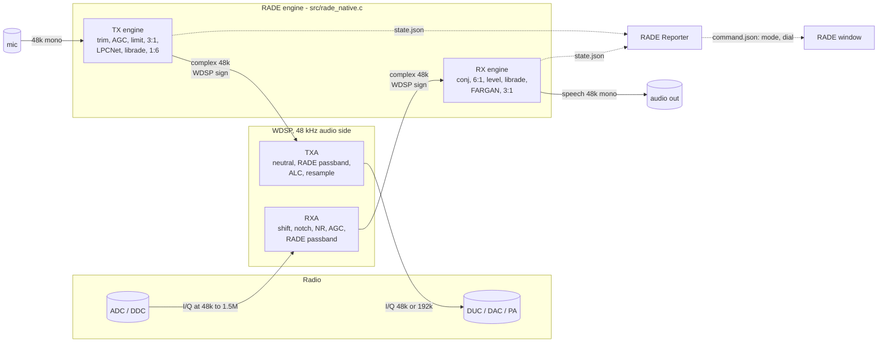
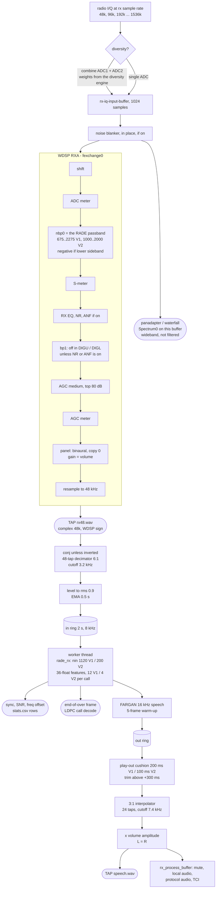
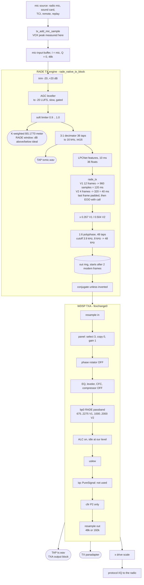
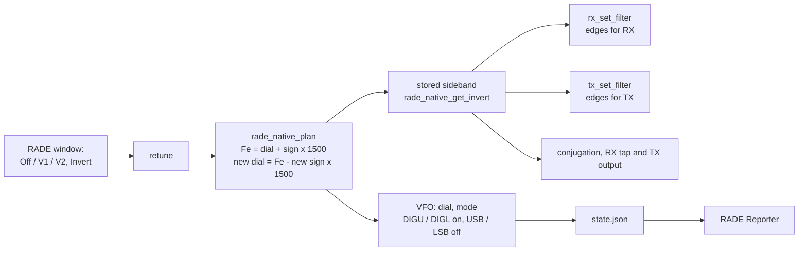

# RADE native: the signal paths

The receive and transmit paths as they are built, what each stage does to the signal, and which stage each
thing we **display**, **report** and **log** is taken from. The point is to be able to say, for any number on
a screen, in a log or on the reporter, *where in the signal it was measured*, and to see what changed when we
optimise. Keep it current: see "Keeping this document true" at the end, and add a line to the change log
(section 9) with every change to a stage, a rate, a filter, a level or a tap.

Diagrams are Mermaid (rendered by GitHub); every diagram is followed by a table that says the same in text.
Code is on `feature/rade-native`; file names are given so a stage can be found with `grep`.

## 0. The one-page picture

| Fact | Value |
|---|---|
| Modem rate | 8 kHz complex (librade); speech 16 kHz (LPCNet, FARGAN) |
| Our rate inside piHPSDR | 48 kHz, both directions, at the WDSP interface |
| WDSP sign convention | positive filter edges = signal at **negative** `I + jQ` frequency; librade and Kiwi IQ are the opposite |
| Where the energy sits | `Fe = dial + sign * 1500 Hz`, `sign` +1 upper, -1 lower; the dial is the carrier of the sideband in use |

## 1. Conventions (get these wrong and everything is mirrored)

| Thing | Convention | Consequence in the code |
|---|---|---|
| WDSP I/Q | USB is `I - jQ`; a positive passband edge selects the tone at negative numpy frequency | the engine conjugates the sample (Q negated) **unless inverted**, at the RX tap and at the TX output (`rade_native_conjugate()`) |
| librade | modem carriers at **positive** frequency of `I + jQ`: V1 750..2200 Hz, V2 1062.5..1937.5 Hz | everything inside the engine is in this convention |
| Kiwi IQ | positive frequency is above the tuned frequency (measured on WWV) | `kiwi_rx.py` conjugates an inverted signal, not a normal one |
| Dial | the suppressed carrier of the sideband in use (CTUN frequency when CTUN is on) | what the VFO shows, what the Reporter is told, what captures record |
| Energy centre `Fe` | `dial + sign * 1500`; V1's carrier centre is 1475 and stays in the filter edges | does not move when waveform or Invert changes: the dial moves instead (section 4) |
| Levels | WDSP audio is +-1.0 full scale; the engine hands librade rms 0.9 (RX) and gives WDSP 0.357 (V1) / 0.504 (V2) (TX); loudness is LUFS (ITU-R BS.1770) | |

## 2. Receive path

| # | Stage | Rate / domain | Code | What it changes | Tunables |
|---|---|---|---|---|---|
| 1 | radio I/Q, diversity combine | rx rate, complex | `receiver.c` `rx_add_iq_samples`, `rx_add_div_iq_samples` | combines two antennas when diversity is on | diversity menu |
| 2 | noise blanker | rx rate | `rx_full_buffer` (`xanbEXT` / `xnobEXT`) | in place, **before** the display and WDSP | rx->nb |
| 3 | panadapter feed | rx rate | `Spectrum0(1, rx->id, ..., rx->iq_input_buffer)` | none (display only); shows the **whole** band, not the RADE passband | |
| 4 | WDSP RXA | to 48 kHz | `wdsp/RXA.c` `xrxa` order above | shift, notch, S-meter, EQ/NR/ANF if on, AGC, panel; **nbp0 is the RADE passband**, `bp1` is off in DIGU/DIGL unless NR/ANF is on (`RXAbp1Set`, `wdsp-review.md`) | `rx_set_filter`, `rx_set_agc`, `rx_set_af_binaural` |
| 5 | RADE passband override | | `rx_set_filter` (`#ifdef RADE_NATIVE`) | edges from `rade_native_wdsp_edges()`, stored sideband | `RADE_NATIVE_BW_V1` 1600, `_V2` 1000, centre 1475 / 1500 |
| 6 | panel in binaural | 48 kHz complex | `rx_set_af_binaural` | copy 0 keeps I and Q; gain1 is the volume | |
| 7 | **tap `rx48.wav`** | 48 kHz float32 stereo, I = L, Q = R | `cap_push_iq` | none | |
| 8 | conjugate, decimate 6:1 | 48 kHz -> 8 kHz | `rade_native_rx_block` | -1 on Q unless inverted; FIR 48 taps | `DEC`, `DEC_TAPS` |
| 9 | level | 8 kHz | same | scales to rms 0.9, EMA tau 4000 samples (0.5 s) | `TARGET_RMS` |
| 10 | librade RX | 8 kHz in, features out | `worker()` | sync, SNR, offset, decode, end-of-over | V1 / V2 |
| 11 | FARGAN | 10 ms of speech per feature frame | `worker()` | 16 kHz speech | |
| 12 | play-out | 16 kHz -> 48 kHz | `rade_native_rx_block` | cushion, 3:1 interpolation, volume | `PREBUFFER_V1/V2`, `MAX_EXTRA`, `INT_TAPS` |
| 13 | **tap `speech.wav`**, audio | 48 kHz mono | `cap_push_speech` | | |

Notes: stage 3 is the only thing the panadapter sees; the passband drawn on it is `rx->filter_low/high`, which
for RADE are the override edges of stage 5. The S-meter is WDSP's (after the notch, before the AGC): it is not
the RADE SNR.

## 3. Transmit path

| # | Stage | Rate / domain | Code | What it changes | Tunables |
|---|---|---|---|---|---|
| 1 | mic sources, VOX | 48 kHz mono | `tx_add_mic_sample` | VOX peak (the mic bar in the VOX menu) is taken **here**, before everything below | |
| 2 | trim, leveller, limiter | 48 kHz | `lv_process` | gain; the limiter keeps peaks under full scale | trim +-20 dB, leveller on/off |
| 3 | loudness meter | 48 kHz | `lv_process` -> `rade_native_tx_level` | none: K-weighting, 100 ms blocks, gated, 10 s | `RADE_NATIVE_TARGET_LUFS` -20, `RADE_NATIVE_RIGHT_DB` 3 |
| 4 | decimate to 16 kHz | | `rade_native_tx_block` | 36 taps, cutoff 7.2 kHz | `TX_DEC`, `TX_DEC_TAPS` |
| 5 | **tap `txmic.wav`** | 16 kHz int16 | `cap_push_mic` | | |
| 6 | LPCNet, `rade_tx`, EOO | 10 ms frames -> 8 kHz | `tx_worker`, `tx_frame`, `tx_finish` | the modem signal; at the end the EOO frame with the callsign (V1, LDPC) | |
| 7 | level and interpolate | 8 kHz -> 48 kHz | `tx_emit` | x 0.357 V1 / 0.504 V2; 48-tap polyphase | `TX_LEVEL_V1/V2`, `TX_INT_TAPS` |
| 8 | jitter cushion | 48 kHz | `rade_native_tx_block` | output starts once two modem frames are queued | |
| 9 | conjugate | | same | -1 on Q unless inverted | |
| 10 | WDSP TXA | 48 -> 48 or 192 kHz | `wdsp/TXA.c` `xtxa` order above | **bp0 = the RADE passband**; ALC; resample out. The speech stages are held off by `tx_xmit_captured_data_start` and by the guards in `tx_set_compressor/equalizer/phrot/dexp` | `tx_set_filter` |
| 11 | **tap `tx.wav`**, TX panadapter | TXA output rate, float32 stereo | `rade_native_capture_tx`, `Spectrum0(tx->iq_output_buffer)` | none | |
| 12 | drive scale, protocol | | `tx_full_buffer` | power; PA | drive slider |

End of an over: `radio_set_mox(0)` is held (`rade_native_tx_end_request`): remaining speech, silence to complete
the modem frame, the EOO frame, then `TX_TAIL` = 5120 samples (107 ms) for WDSP's TX filters, then the radio
is released. Measured hold after the last mic sample: 0.58 to 0.62 s V1, 0.38 s V2.

## 4. What sets the passband, the sideband and the dial

- The sideband is **stored** when chosen (waveform, Invert), not recomputed from the dial. V1 is lower sideband
  below 10 MHz by default, V2 upper, **both upper on 60 m (5250-5450 kHz, where USB is the convention)**; Invert is an exclusive-or on that.
- Any change moves the dial so that `Fe` is constant: 160 m with `Fe` 1985.5 kHz, V1 is the LSB carrier 1987.0,
  V2 is the USB carrier 1984.0, Off leaves the radio on LSB 1987.0 or USB 1984.0. Table of all cases:
  `test/rade_native/modes_table`.
- Tuning across 10 MHz by over 100 kHz, or into or out of 60 m, re-applies the band default (sideband and mode only).

## 5. What we display, report and log, and where it comes from

| Item | Shown / sent where | Taken from | Units / meaning | Not to be confused with |
|---|---|---|---|---|
| Panadapter, waterfall | main window | RX stage 3: raw wideband I/Q | dBFS vs frequency | the RADE passband (drawn on it) |
| S-meter | main window | WDSP RXA S-meter (stage 4) | S-units / dB | the RADE SNR |
| RADE sync, SNR, offset | RADE window; Reporter "Receiving:" | librade, RX stage 10 | SNR is **dB in a 3 kHz reference bandwidth**, librade's estimate; offset in Hz | the S-meter; diversity's own SNR |
| Mic bar (VOX menu) | VOX menu | TX stage 1: mic peak before trim and AGC | 0..1 peak | the RADE mic meter |
| Mic meter, "x dB too low / high" | RADE window | TX stage 3: **after** trim, leveller and limiter, K-weighted | LUFS, gated, 10 s average; ideal -20; peak in dBFS before the limiter | the VOX bar |
| ALC meter | TX panel | WDSP ALC (stage 10) | idle by design at our level | the mic level |
| TX panadapter | TX panel | TX stage 11: TXA output | | what the PA radiates |
| Transmitting / Status | RADE window | `radio_is_transmitting()` (held through the end of over) | | |
| Transmitting, as reported | Reporter `tx_report`, `tx_count`, state.json `tx` | `rade_is_tx()`: keyed **and** a RADE waveform on **and** the RADE transmit engine in use (170 ms of RADE samples, none since a TUNE / two-tone / noise began in this key-down) **and** not TUNE or two-tone, **and** seen on two 250 ms polls running (`state_cb`) | an SSB over or a tune in RADE mode is not reported | `radio_is_transmitting()` |
| Frequency | VFO; Reporter `freq_change`; logs | the dial = carrier of the sideband in use | Hz | the energy centre `Fe` (state.json `centre_hz`) |
| Received call | RADE window, `rade-calls.csv`, Reporter `rx_report` | end-of-over frame, LDPC decode | SNR with it is the over's smoothed SNR | |
| Reception report (SNR) | Reporter `rx_report` | librade SNR (live) while in sync, call = last decoded or blank | `int(snr + 0.5)`. A changed SNR is sent up to once a second, an unchanged one every 20 s only while in sync with an SNR; calls first; never repeated otherwise (`Link._push`) | |
| Reporter traffic | Reporter to FreeDV Reporter servers | `Link._push` | nothing while the dial is being tuned; frequency after 5 s stable or at once with lock + SNR; frequency, transmit state, message at most once per 5 s each; identical events not sent; starts OFF, switched off without a fresh piHPSDR state or a valid dial | |
| Callsign (Reporter) | Reporter | the call in piHPSDR's RADE window (state.json `call`), always; no entry box | | the grid, still entered in the Reporter |
| Mode string | Reporter | `RADEV1` / `RADEV2` | | |

## 6. Taps and the tools that read them

| File | Tap | Format | Read by |
|---|---|---|---|
| `_rx48.wav` | RX 7 | float32 stereo 48 kHz, WDSP sign | `test_rx_engine` (replay), `filter_study.py`, spectrum scripts |
| `_speech.wav` | RX 13 | int16 mono 48 kHz | listening; envelope comparisons |
| `_stats.csv` | RX 10 | one row per `rade_rx` call; `rx48_pos` indexes `_rx48.wav` | scoring scripts |
| `_events.log`, `_meta.txt` | | state changes; full settings at start and end | everything |
| `_txmic.wav` | TX 5 | int16 mono 16 kHz | `tx_shape.py` comparison, vocoder re-runs |
| `_tx.wav` | TX 11 | float32 stereo at the TX rate (48 or 192 kHz) | `tx_shape.py` |
| `rade-calls.csv` | | calls with dial, mode, SNR, offset | |
| Kiwi session | off air, 12 kHz IQ | `kiwi_rx.py` | the receive end of our own transmission |

| Question | Script |
|---|---|
| Is the transmitted spectrum what the modem makes? | `tx_shape.py` (centre, tilt, edges, skirts) |
| How does the chain behave offline? | `tx_validate.py`, `loss_check.sh`, `wdsp_probe` |
| Does a mistuned or narrower signal still decode? | `filter_study.py` |
| How do the WDSP filter options (taps, window, linear / minimum phase, edges) change the TX / RX signal and the decode? | `filter_lab.py response|decode` (`filter-lab.md`) |
| How close to the ALC ceiling can the level go? | `alc_sweep.py capture_stem` (offline, 48 kHz TXA; uses the capture's `_txmic.wav`) |
| Is the mic level meter right? | `test_tx_level.py` |
| Does the mode-change rule hold? | `test_geometry` (`make check`), `modes_table` |
| Did it arrive properly off air? | `kiwi_rx.py` |

## 7. Latency and delay budget (measured unless stated)

| Part | Value | Note |
|---|---|---|
| WDSP TXA + RXA with the default filters | 248.6 ms measured with `bp1` forced on; about 227 ms as the radio runs it (RX 106.6 ms, not 128) | linear-phase FIRs; of the rest, `dsp_size` 2048 buffering is 85 ms RX / 43 ms TX (`wdsp-review.md`); kept as is |
| RX play-out cushion | 200 ms V1, 100 ms V2 | speech arrives a modem frame at a time (120 ms V1, 40 ms V2) |
| TX cushion | 2 modem frames: 240 ms V1, 80 ms V2 | stops holes of zeros in the signal |
| End of over hold | 0.58 to 0.62 s V1, 0.38 s V2 | |
| TX engine + WDSP + RX engine, clip start to first decoded speech | about 1.9 s (V1, one clip) | not broken down by stage |

## 7a. TX level and the ALC (measured 2026-10-16)

**Question:** how close to the WDSP ALC ceiling can the modem level go without hurting? **Method:**
`test/rade_native/alc_sweep.py 20261016-005144`: the first 30 s of the speech that went into the vocoder
(`_txmic.wav` of the capture) through `rade_tx`, scaled, WDSP TXA (neutral, ALC on, 48 kHz), optional white
noise, WDSP RXA (medium AGC), librade RX. Levels in dB around the engine's (V1 0.357, V2 0.504).

| level re current | V1 peak out dBFS | V1 TXA gain | V1 clean SNR est. | V2 peak out dBFS | V2 TXA gain | V2 clean SNR est. |
|---|---|---|---|---|---|---|
| -3.0 | -2.02 | +5.70 | 32.2 | -2.51 | +6.00 | 18.2 |
| -1.5 | -0.52 | +5.70 | 32.2 | -1.01 | +6.00 | 18.2 |
| 0 | -0.02 | +5.69 | 32.3 | -0.02 | +5.98 | 18.2 |
| +1.5 | -0.02 | +4.71 | 29.4 | -0.02 | +4.75 | 18.0 |
| +3 | -0.02 | +3.22 | 28.4 | -0.02 | +3.26 | 18.0 |
| +6 | -0.02 | +0.22 | 28.4 | -0.02 | +0.26 | 18.0 |
| +9 | -0.02 | -2.78 | 28.4 | -0.02 | -2.74 | 18.0 |

Feature error (fraction of variance) is flat: V1 0.0206-0.0207, V2 0.0146-0.0151 at all levels; with noise added
(white, 48 kHz, level fixed in absolute terms) neither feature error, sync nor SNR got worse with level.

**Reading:** at the current levels the ALC is already at its ceiling for this speech; above that every dB of extra
level is taken back as a dB less TXA gain, so the output power does not rise, and the decode is not measurably
harmed. The ceiling is therefore the limit, and the best level is where peaks just reach it. V1's clean SNR
estimate falls 3.9 dB where it first touches the ceiling (clipping noise of the ALC), V2's 0.2 dB; the
decoded features do not change.

**Not explained:** the live capture 20261016-005144 peaked at -0.97 dBFS at the 192 kHz TXA output
(rms 0.55, nothing within 1 % of 1.0) where this offline run peaks at -0.02 dBFS. The offline run is 48 kHz
and has no CFIR or 192 kHz resampler; I have not tested whether that accounts for it, and I do not know which
build the radio was running (the binary on disk was built before the capture). **Not measured:** weak-signal
SNR (the noise used gives 16-20 dB, not the 0-10 dB where this would matter), fading, the live leveller, other
speech, the effect on the PA.

**Off-air check, same session** (Kiwi, 14250.0 kHz, V1, 37.8 s over, iq / iq-fixed / usb profiles agree): 100 % in
sync, SNR 25.3 dB (min 12.8, max 26.9), +5.6 Hz offset, EOO 0.12 s after sync ended, call EI6IZ decoded. Locally
(`tx_shape.py`): centre +1467 Hz (modem +1457), tilt -0.2 dB, PASS; this confirms the speech-stage fix. An earlier
45 s over (before the capture) read the same, 25.2 dB.

## 8. Parameter register (current values)

| Where | Name | Value |
|---|---|---|
| `rade_native.h` | `RADE_NATIVE_FC_V1`, `_V2` | 1475, 1500 Hz |
| | `RADE_NATIVE_BW_V1`, `_V2` | 1600, 1000 Hz |
| | `RADE_NATIVE_DIAL_OFFSET` | 1500 Hz |
| | `RADE_NATIVE_V1_INV_BELOW_HZ` | 10 000 000 |
| | `RADE_NATIVE_TARGET_LUFS`, `_RIGHT_DB` | -20, 3 |
| `rade_native.c` RX | `DEC`, `DEC_TAPS` | 6, 48 (cutoff 3.2 kHz) |
| | `TARGET_RMS`, level EMA | 0.9, 1/4000 per 8 kHz sample |
| | `IN_RING` | 16384 (2 s) |
| | `PREBUFFER_V1`, `_V2`, `MAX_EXTRA` | 3200, 1600, 4800 (16 kHz samples) |
| | `INT`, `INT_TAPS` | 3, 24 (cutoff 7.4 kHz) |
| `rade_native.c` TX | `TX_DEC`, `TX_DEC_TAPS` | 3, 36 (cutoff 7.2 kHz) |
| | `TX_INT`, `TX_INT_TAPS` | 6, 48 (cutoff 3.9 kHz) |
| | `TX_LEVEL_V1`, `_V2` | 0.357, 0.504 (was 0.3 both), times the Drive slider (-6..+6 dB) |
| | `TX_TAIL` | 5120 samples (107 ms; was 8000 = 167 ms until 2026-10-16) |
| | leveller | gain held through RX and between overs; changes only while transmitting and only on speech (400 ms loudness before the gain >= -35 LUFS, within 15 LU of the over's loudest, within 10 LU of the speech average); up 0.2..0.5 dB/s, down 0.5 dB/s, 2 dB/s for a shout > 8 dB over, range -30..+20 dB |
| | limiter | knee 0.9, ceiling 1.0 |
| WDSP (TX filter) | `bp0` | 2048 taps at the WDSP DSP rate (96 kHz on P2), 7-term BH, linear phase, edges V1 675..2275 / V2 1000..2000; see `filter-lab.md` |
| WDSP (RX filter) | `nbp0` alone (`bp1` off in DIGU / DIGL; on, with gain 2.0 and +21 ms, if NR or ANF is on) | 2048 taps at 48 kHz, 4-term window, linear phase (`low_latency` 0), RADE edges |
| WDSP (operator) | RX AGC | medium, top 80 dB |
| WDSP (ours) | TX panel | select 3, copy 0, gain 1; EQ, leveler, CFC, compressor, DEXP, phase rotator off |

## 9. Change log of the signal path

Newest first. One line per change that can move a measurement. "Check" is the script that should show it;
"status" is what has actually been seen. Add the line **with the commit that makes the change**.

| Date | Commit | Change | Expected effect | Check | Status |
|---|---|---|---|---|---|
| 2026-10-16 | (this commit) | V2 callsign sent on the data-symbol channel: `rade_tx_set_data_symbol()` before every V2 `rade_tx()` frame, 25 symbols/s, repeating LDPC(112,56) stream of the Call box (`src/rade_v2_text.c`, wire-identical to freedv-gui's `rade_text_tx_next_symbol`); none set: constant -1.0 | no change to the modem signal's spectrum or level (one BPSK symbol already in every V2 frame); the callsign is readable by freedv-gui's V2 receiver after about 5 s of reception (8 characters or fewer), longer for longer calls | `v2_text_interop` (stream equals freedv-gui's bit for bit for 14 callsigns; its receiver decodes ours clean, with noise, through librade V2); `test_v2_text.py` (the real engine's output decoded, clean and at 9 / 6 dB) | offline only; not on air |
| 2026-10-16 | (this commit) | V2 callsign received: the engine worker feeds `rade_rx_get_data_symbol()` to `rade_v2_text_rx_symbol()` (port of freedv-gui's text receiver); a completed message is queued as a call (once per reception), reset when sync is lost; call buffers 40 characters | a V2 station's callsign appears in the calls list, the log and the Reporter (as for V1) | `interop` part D (identical to freedv-gui's receiver), `test_v2_text.py` (receive engine, 6 dB) | built, not on air |
| 2026-10-16 | (this commit) | V2 callsign: lock is the gate; after a lock loss the new lock's first 96 symbols are correlated with the collected cycle at the elapsed-time position: same sender -> gap bridged, call built over the transmission; other sender -> start afresh | a call is pieced together across drop-outs (weak signals), never mixed between senders | `interop` part E, `test_v2_text.py` | built, not on air |
| 2026-10-16 | 60f3e3ee, d3d4b479, 11c0c8f1 | Reporter traffic paced: silent while tuning, frequency after 5 s stable (or lock + SNR), one event per kind per 5 s, reception reports 1 s when the SNR changes / 20 s keep-alive when steady and in sync, no repeats; Show follows the radio mode; call from the RADE window; blue only for stations receiving with a recent SNR | no RADE signal-path change; far fewer events to the servers | `test_reporter.py` `pacing()`, `test_gui_*.py` | tested against mock servers and a fake clock; not against a live reporter |
| 2026-10-16 | 11a1791c | Parameter log: run directory of tables (rx / tx 2 Hz, events, overs, tx_overs, tar.gz) | no signal-path change | `test_log.py`, `log_analysis.py` | scripted scene only; first live run pending. Old logs converted (`tools/rade-logview/convert_old_logs.py`); viewer `tools/rade-logview/rade_logview.py` |
| 2026-10-16 | 65ff05d7 | 60 m (5250-5450 kHz): V1 and V2 default to upper sideband, Invert below the carrier | dial = carrier of the USB sideband on 60 m | `test_geometry`, `modes_table` | built; not on air |
| 2026-10-16 | ec490935 | `TX_TAIL` 8000 -> 5120 samples | radio released about 60 ms sooner, about 20 ms margin | `air_timing.py` (`unkey_after_wdsp_last_ms` about 64, EOO still decoded) | not yet re-measured |
| 2026-10-16 | (this commit) | TX level into WDSP per waveform: V1 0.3 -> 0.357 (+1.5 dB), V2 0.3 -> 0.504 (+4.5 dB), 0.5 dB under the ALC ceiling on request | ALC meter peaks at -0.5 dB for both (was -2 V1, -5 V2, as read by the operator) | ALC meter on the next TX; `tx_shape.py` peak | compiled; **not on a radio**; ALC clamp at 1.0 will clip any overshoot, watch SNR |
| 2026-10-16 | 1e4c3404 | Sideband stored; dial and VFO mode follow it (`rade_native_plan`); RADE off returns to USB/LSB on the same carrier; dial = CTUN freq | `Fe` constant across waveform / Invert / Off; Reporter frequency = carrier | `test_geometry`, `modes_table` | unit-tested; not on a radio |
| 2026-10-16 | 73c3925c | Speech stages kept off while RADE TX is on (`tx_set_compressor/equalizer/phrot/dexp` guards, phase rotator off) | TX energy centre +1650 -> about +1457 Hz; tilt +4.8 -> 0 dB | `tx_shape.py` on the next TX capture | compiled; **next capture decides** |
| 2026-10-15 | f1d7af06 | Mic trim (+-20 dB), leveller, soft limiter, LUFS meter | mic level adjustable, meter reads dB re -20 LUFS | `test_tx_level.py` | tested offline; not with a real mic |
| 2026-10-15 | d30da2ae | End-of-over hold; callsign in the EOO (V1, LDPC); TX output starts after two modem frames | EOO decodes reliably; no zero holes | `tx_validate.py` (call EI6IZ, 12 of 12) | tested offline; on air: calls seen |
| 2026-10-15 | 5d704cfc | TX path first cut: engine, TXA neutral, panel select 3, `bp0` RADE edges, TX capture | RADE transmitted through WDSP | `tx_validate.py` | worked on air |
| 2026-10-15 | e9f96180 | RX path first cut: tap after WDSP, 6:1, level, worker, FARGAN, 3:1; cushion; fixed 8-of-12 frame truncation | V1 and V2 decode, no underruns | `test_rx_engine`, envelope vs original 0.90 / 0.92 | worked on air |
| 2026-10-15 | 2f12e43c | WDSP sign convention measured (conjugate of librade's) | conj at both interfaces | `t11_wdsp_probe.py` | measured |

### Open measurements to add when seen

- 2026-10-16 `alc_sweep.py` (speech of capture 20261016-005144, 30 s, offline at 48 kHz): at the current levels the ALC is already at its ceiling (peak -0.02 dBFS); raising the level further only lowers the TXA gain one for one (+5.7 dB at the current level, -2.8 dB at +9 dB), output rms does not rise, and ferr / SNR do not get worse; the live capture peaked at -0.97 dBFS at 192 kHz, a ~1 dB difference not explained.

- the first TX capture after 73c3925c: `tx_shape.py` PASS?
- the first off-air Kiwi capture of one of our overs: SNR / loss / end-of-over / call against the local numbers
- the RX AGC and TX ALC with a fading signal (T-9, T-10 in `plan.md`)

## 10. Keeping this document true

When you change a stage, a rate, a filter, a level, a tap or what is shown or reported:

1. change the diagram and the stage table in the same commit;
2. update the parameter register if a value moved;
3. add a line to the change log with the commit, the expected measurable effect and the check;
4. when the check has been run, fill in the status (what was seen, on what).

A stage not in section 2 or 3 is a stage nobody has looked at.
